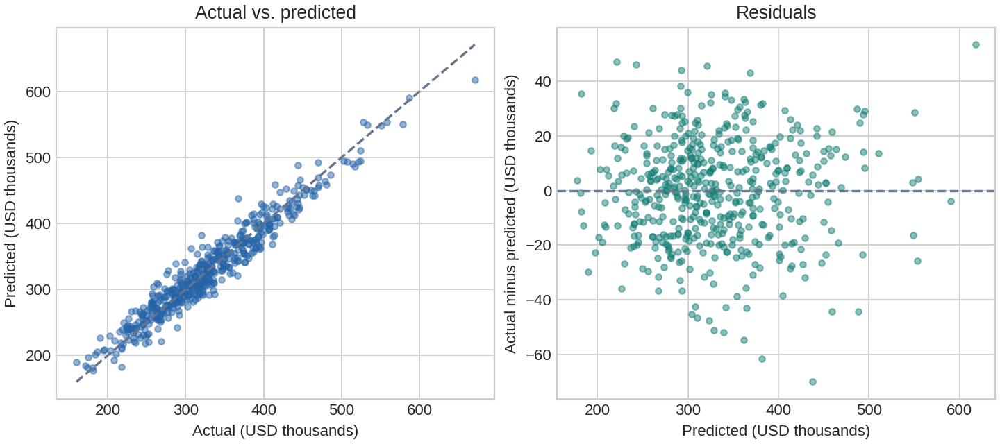
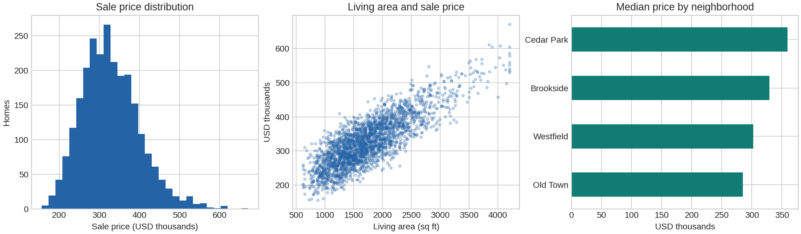

# House Price Prediction with Classic Machine Learning

**Can a simple linear model beat a random forest when predicting house prices?**

In this synthetic housing market, linear regression had the lowest cross-validation mean absolute error (MAE). On 500 held-out sales, its predictions were off by **$15,176 on average**, compared with **$57,302** for a median-price baseline.



## 1. Dataset and cleaning

The included CSV contains 2,520 fictional property records, generated with a fixed seed. It includes living area, lot area, quality, year built, bedrooms, bathrooms, garage spaces, renovation status, neighborhood, and house style. The target is sale price in USD.

The cleaning script removed 20 duplicate rows and one record with an invalid sale price, leaving 2,499 observations. It normalized category text and converted invalid feature values to missing values. Property IDs are excluded from model features.

See the [data dictionary](data/README.md) for column definitions and generation assumptions.

## 2. Exploratory analysis

The charts compare the distribution of sale prices, the relationship between living area and price, and median prices across neighborhoods. Larger homes generally sold for more in the simulation. Neighborhood differences reflect premiums built into the generator.



## 3. Feature engineering and model comparison

The pipeline calculates home age and the lot-to-living-area ratio. It imputes missing numeric values with the training median, adds numeric missingness indicators, scales numeric inputs, and one-hot encodes categorical inputs. Missing categories get their own label. Unseen categories are accepted at inference.

A fixed 80/20 split reserved 500 rows for evaluation. Five-fold cross-validation on the 1,999 training rows selected the model by lowest MAE. Each fold fitted preprocessing independently.

| Model | Mean validation MAE |
| --- | ---: |
| Linear regression | $14,531 |
| Ridge regression | $14,559 |
| Gradient boosting | $15,726 |
| Random forest | $18,787 |
| Median baseline | $56,239 |

## 4. Held-out results

| Metric | Result | Interpretation |
| --- | ---: | --- |
| MAE | $15,176 | Average absolute error in dollars |
| RMSE | $19,007 | Dollar error metric that penalizes larger errors more |
| R² | 0.935 | Share of variation explained on this test split |
| Median baseline MAE | $57,302 | Test error from predicting the training-set median for every house |
| MAE reduction | 73.5% | Relative improvement over the median baseline |

Permutation importance ranked living area, neighborhood, year built, and overall quality highest. It measures how much test MAE increases when one input is shuffled. Correlated inputs can share or mask predictive signal. The rankings describe the fitted model on simulated data.

The price generator is mostly additive, which helps explain why linear regression performed well. The benchmark uses fixed settings for each model. Results describe a fictional market and cannot validate pricing performance on real properties.

## 5. Run the project

Use **Python 3.12**. From the extracted project folder on macOS or Linux:

```bash
python3.12 -m venv .venv
source .venv/bin/activate
python -m pip install -r requirements.txt
python -m streamlit run app.py
```

On Windows PowerShell, use `py -3.12 -m venv .venv` and activate with `.\.venv\Scripts\Activate.ps1`.

The app includes an EDA and model results dashboard, an individual property form, and CSV upload with downloadable estimates. A fitted pipeline and reports are bundled. Load the bundled model or one generated locally from this project.

To rebuild the model and charts and score the included example:

```bash
python -m src.train
python -m src.eda
python -m src.predict data/example_scoring.csv predictions.csv
```

Run `python -m src.generate_data` to recreate the raw dataset and sample CSV.

## Project files

| Path | Contents |
| --- | --- |
| `data/` | Raw data, sample scoring CSV, and data dictionary |
| `src/generate_data.py` | Reproducible synthetic data generator |
| `src/clean.py` | Row checks, category normalization, and numeric validation |
| `src/transform.py` | Feature engineering and reusable scikit-learn pipeline |
| `src/train.py` | Baseline, cross-validation, held-out evaluation, and model export |
| `src/eda.py` | Exploratory plots and test diagnostics |
| `src/predict.py` | Batch scoring entry point |
| `app.py` | Streamlit dashboard and prediction interface |
| `models/` | Fitted preprocessing and model pipeline |
| `reports/` | Charts, metrics, held-out predictions, and feature importance |
| `POST_DRAFT.md` | Portfolio post draft |

## GitHub upload

Create a new empty GitHub repository named `House_Price_Prediction`. In Terminal, open the extracted project folder, replace `YOUR_USERNAME`, and run:

```bash
git init
git add .
git commit -m "Add house price prediction project"
git branch -M main
git remote add origin https://github.com/YOUR_USERNAME/House_Price_Prediction.git
git push -u origin main
```
